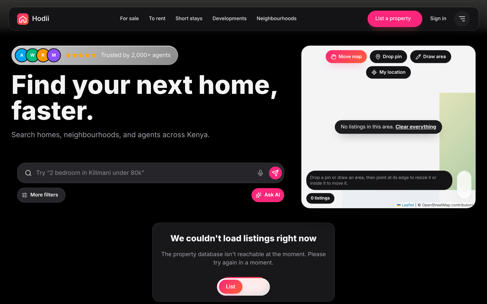
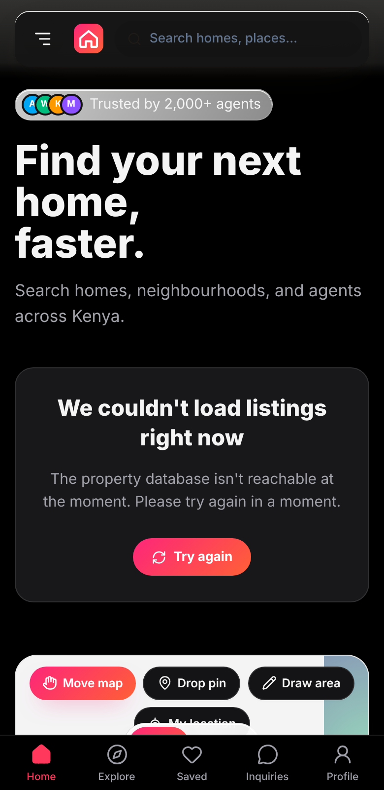
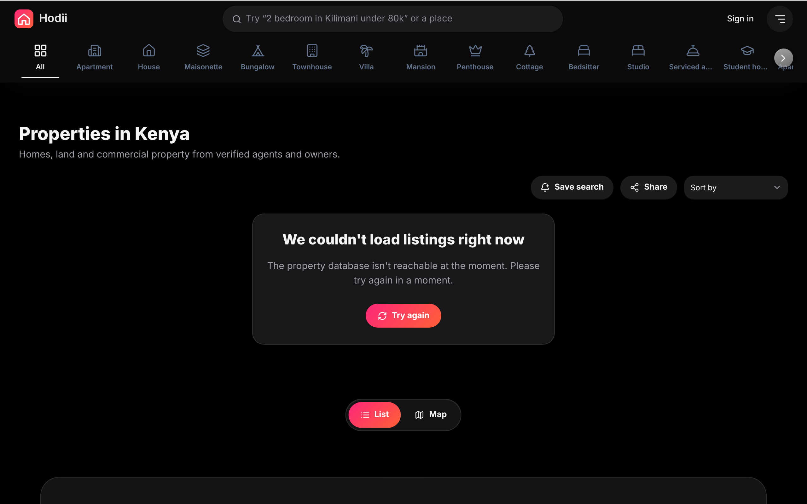

# Hodii

Kenya's property marketplace: homes, land and commercial space for sale and to rent, with verified agents and agencies, map search and AI search.



<p>
  
  
</p>

## Look and feel

- Dark theme across the whole app (black background, dark-grey cards), driven by shared colour tokens in `src/styles.css`.
- Brand colour is the gradient `#fd267a` to `#ff6036` (`--brand-gradient`). Primary buttons, the logo and the PWA icons all use it.
- The logo is the gradient rounded square with a white house outline (`src/components/brand-logo.tsx`, `public/favicon.svg`, PWA icons in `public/`).
- On phones (under 768px) the bottom navigation bar shows and the phone layout applies; wider screens use the medium and large layouts.

## Run it

```sh
npm i
npm run dev      # development
npm test         # unit tests
npm run build    # production build
```

Create a `.env` file for your secrets (database connection and so on). `.env` is git-ignored; never commit it.

## Deploy

Deploys to Vercel. Set the same environment variables in the Vercel project settings, then deploy from your git repository or with `vercel --prod`.

## PWA

`public/site.webmanifest`, `public/sw.js` (bump `VERSION` to drop old caches), icons `icon-192.png`, `icon-512.png`, `icon-maskable-512.png`, `apple-touch-icon.png`, and iOS splash images in `public/splash/`.

## Built with

TanStack Start, TypeScript, React, Tailwind CSS v4, MongoDB, Leaflet, Zod.
